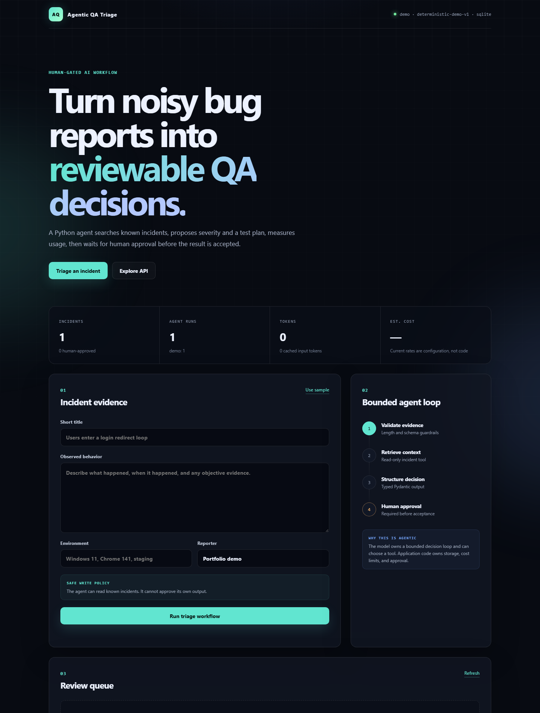
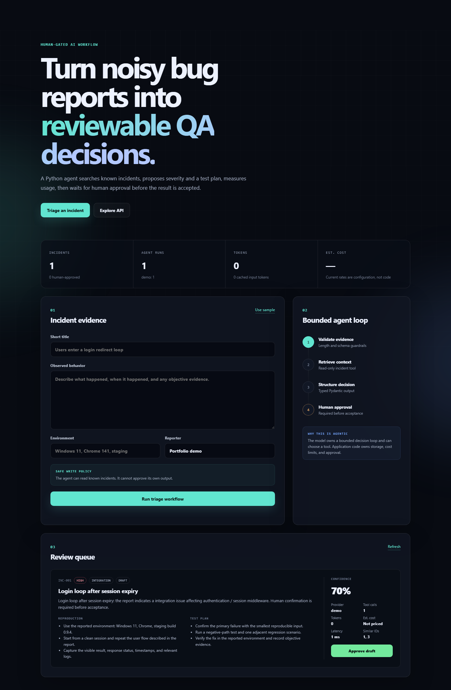

# Agentic QA Triage

Cost-aware incident triage built with Python, OpenAI Agents SDK, FastAPI, and PostgreSQL.

The application turns an unstructured bug report into a structured QA draft: severity, category,
suspected component, reproduction steps, missing information, and a focused test plan. The agent
can search a reviewed incident knowledge base, but it cannot approve its own result.



## Why this project exists

Real incident reports are often incomplete, inconsistent, and expensive to review. This project
demonstrates how to add an LLM agent to a normal Python application without giving the model
unbounded control over persistence or cost.

## What it demonstrates

- OpenAI Agents SDK with a focused Python agent and a read-only function tool
- structured Pydantic output instead of free-form text parsing
- FastAPI endpoints and a responsive portfolio dashboard
- PostgreSQL configuration through Docker Compose
- SQLite fallback for zero-setup demos and deterministic CI tests
- human approval before an AI-generated draft becomes accepted data
- per-run latency, tool-call, token, cached-token, and optional cost tracking
- bounded input, agent turns, and output size for cost control
- pytest coverage and GitHub Actions CI

## Workflow

```text
Incident evidence
      |
      v
Schema + size validation
      |
      v
QA triage agent ---- read-only tool ----> Known incidents
      |
      v
Typed draft + usage record
      |
      v
Human review and approval
```



The OpenAI SDK runs only when `AGENT_PROVIDER=openai`. The default `demo` provider executes the
same API, database, dashboard, and approval workflow deterministically, with no API call.

## Quick start: zero-cost demo

```powershell
py -3.12 -m venv .venv
.venv\Scripts\python -m pip install -e ".[dev]"
Copy-Item .env.example .env
.venv\Scripts\agentic-qa-triage
```

Open `http://127.0.0.1:8000` and select **Use sample**.

Run the checks:

```powershell
.venv\Scripts\python -m ruff check .
.venv\Scripts\python -m pytest
```

## Run with the OpenAI agent

Set these values in `.env` without committing the file:

```dotenv
AGENT_PROVIDER=openai
OPENAI_API_KEY=your_api_key
OPENAI_MODEL=gpt-5-mini
```

Then start the same command. The model is configurable so deployment can choose the appropriate
quality/cost point without changing application code.

## Run with PostgreSQL

Docker Compose starts the app and PostgreSQL together:

```powershell
Copy-Item .env.example .env
docker compose up --build
```

The app uses `postgresql+psycopg` inside Compose. Automated tests use in-memory SQLite so CI does
not need credentials or an external service.

## Cost accounting

Token counts come from the SDK run context. USD cost is shown only when current rates are supplied:

```dotenv
OPENAI_INPUT_USD_PER_MILLION=
OPENAI_CACHED_INPUT_USD_PER_MILLION=
OPENAI_OUTPUT_USD_PER_MILLION=
```

This avoids publishing a stale model price as if it were permanent. See
[Cost-Efficiency Strategy](docs/COST_EFFICIENCY.md).

## API surface

| Method | Path | Purpose |
|---|---|---|
| `GET` | `/health` | Provider, model, and database mode |
| `POST` | `/api/incidents/triage` | Create a structured draft |
| `GET` | `/api/incidents` | Review recent drafts and approvals |
| `POST` | `/api/incidents/{id}/approve` | Explicit human approval |
| `GET` | `/api/metrics` | Usage and cost summary |
| `GET` | `/docs` | Interactive OpenAPI documentation |

## Design notes

- [Architecture and safety boundaries](docs/ARCHITECTURE.md)
- [Cost-efficiency strategy](docs/COST_EFFICIENCY.md)
- [Interview guide](docs/INTERVIEW_GUIDE.md)

## Tradeoffs

- One focused agent is used instead of a multi-agent graph because the MVP has one clear task
  owner. This reduces calls, latency, and debugging surface.
- Keyword retrieval is intentionally small and inspectable. PostgreSQL full-text search or vector
  retrieval should be added only with an evaluation dataset.
- SQLite improves local review and CI portability; PostgreSQL is the documented deployment path.
- Authentication and role-based approval are outside the current public demo scope.

## AI-assisted development disclosure

This portfolio project was created with AI-assisted implementation. Before presenting it in an
interview, the repository owner should review the code, run the tests, and be able to explain the
architecture, safety boundaries, and tradeoffs in their own words.

## Official reference

The agent workflow follows the current
[OpenAI Agents SDK documentation](https://developers.openai.com/api/docs/guides/agents/sdk),
including application-owned tools, storage, runtime controls, and observability.

## License

MIT
